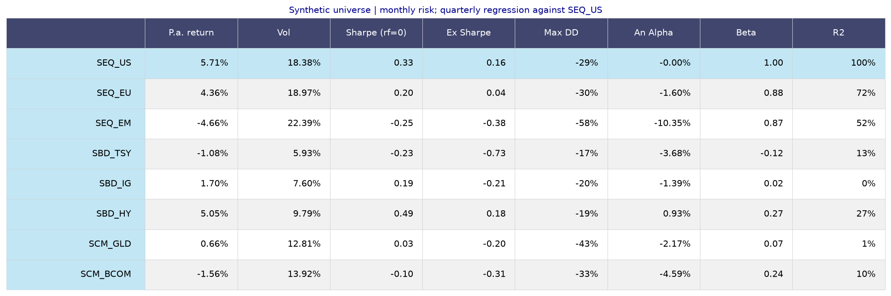
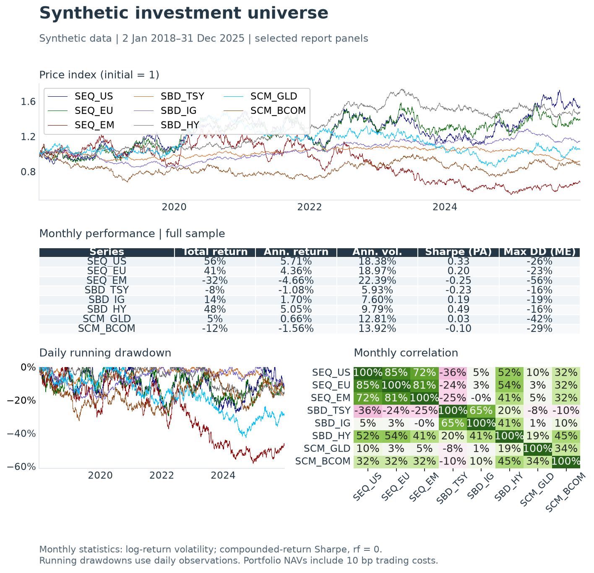
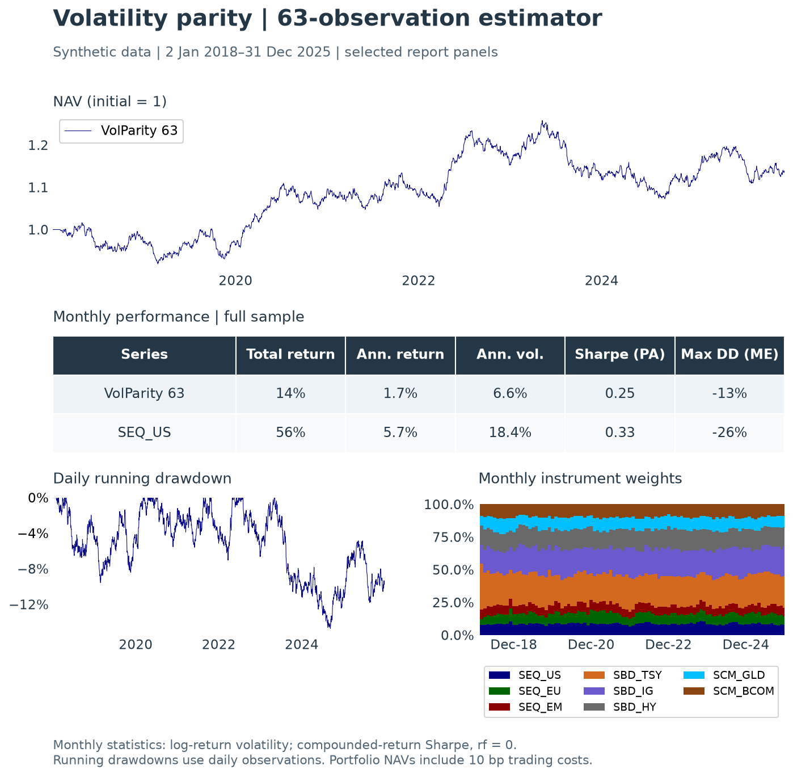
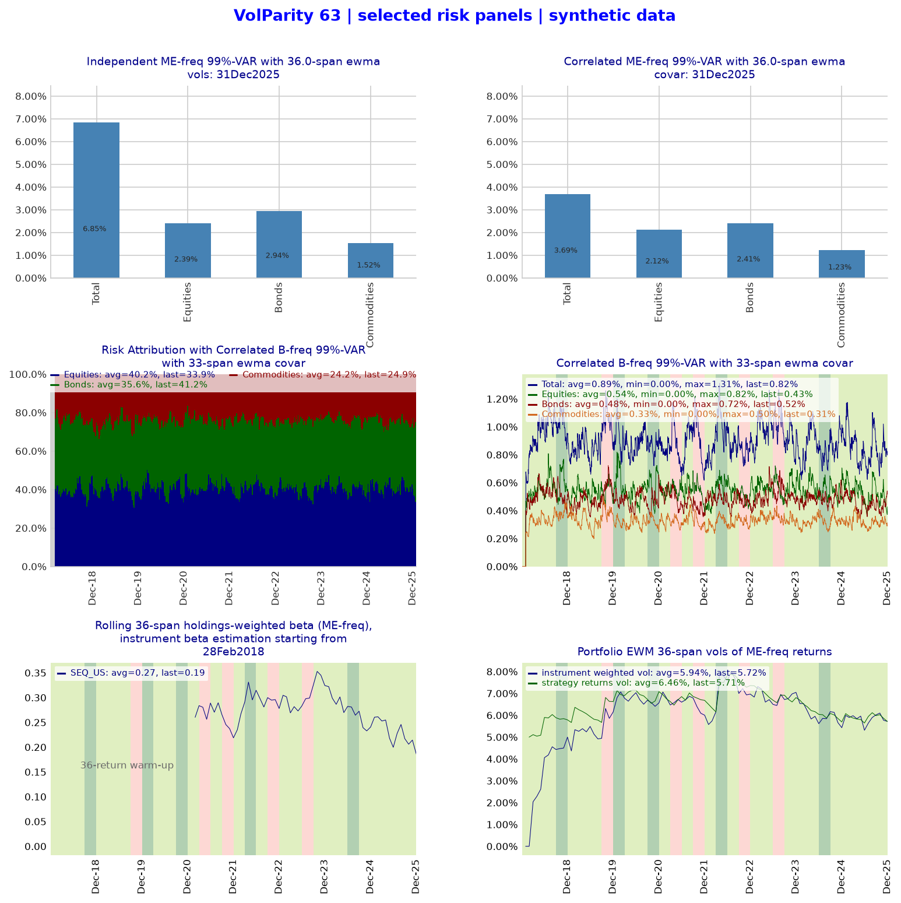
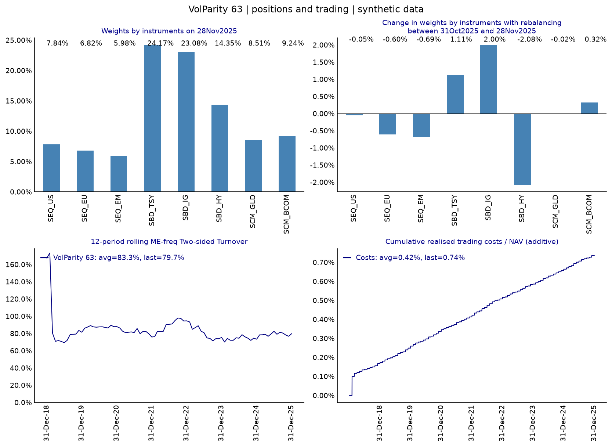
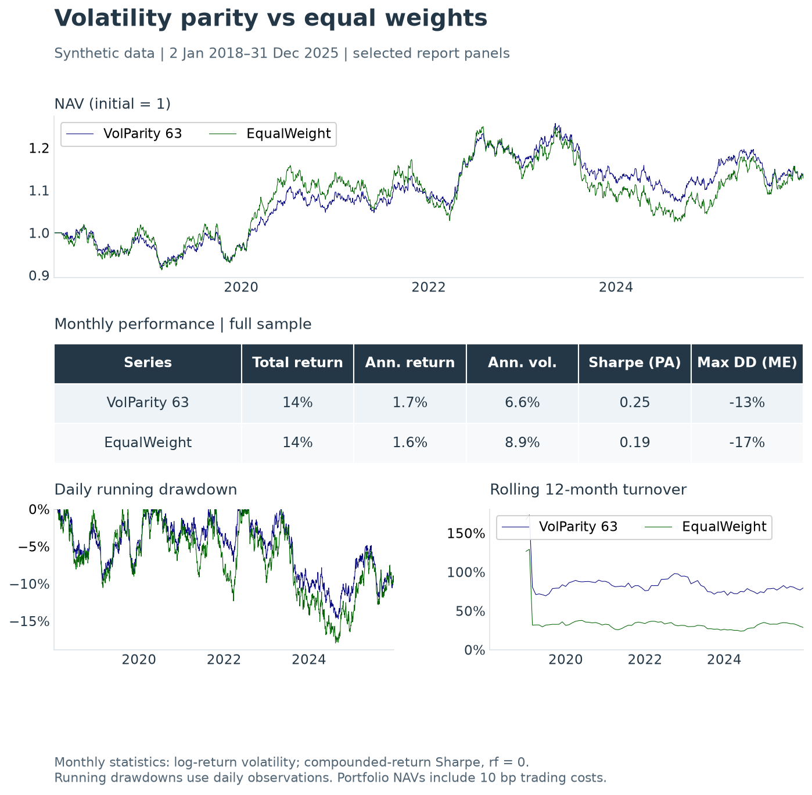
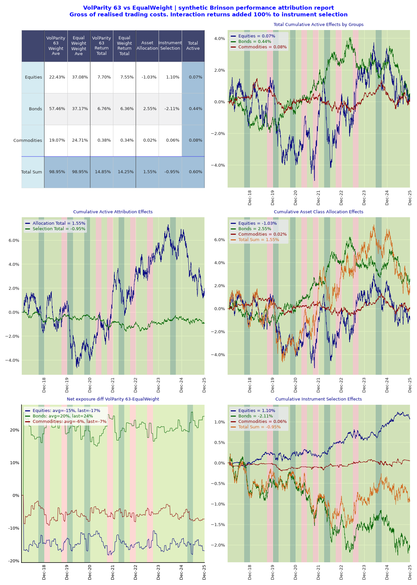
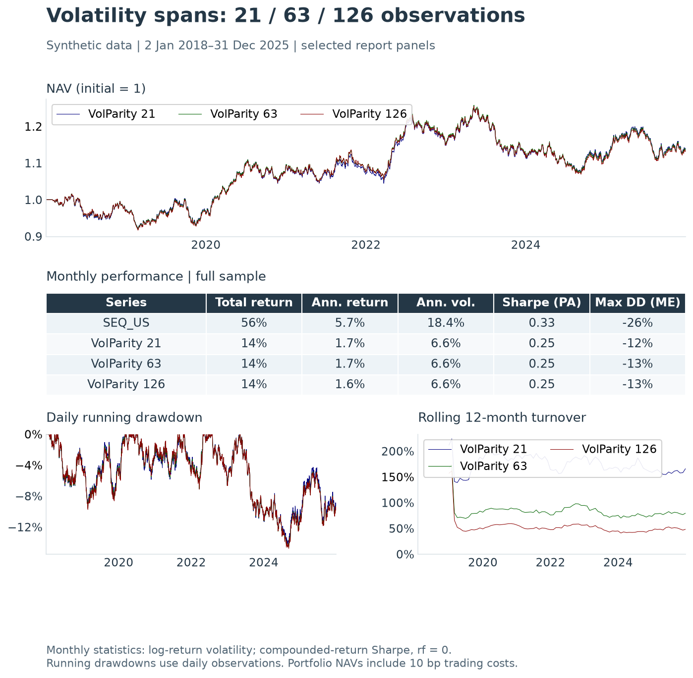

# qis

*Author: [Artur Sepp](https://github.com/ArturSepp) / First recorded: [2022-12-30](https://github.com/ArturSepp/QuantInvestStrats/commit/b5a876000b63b15a3c95ff06e5add4f60beceadc)*

Implemented in [qis — Quantitative Investment Strategies](https://github.com/ArturSepp/QuantInvestStrats).
Software citation: [CITATION.cff](https://github.com/ArturSepp/QuantInvestStrats/blob/main/CITATION.cff).

**Performance analytics, portfolio backtesting, risk analysis, and factsheet reporting in
Python.**

`qis` is for quantitative portfolio managers, researchers and investors who analyse portfolio
performance and backtest investment strategies. Reported results can differ when return
frequency, risk-free-rate treatment and rebalancing conventions are left unstated. The library
makes those conventions explicit and uses shared calculations across analytics, backtests and
reports. `qis` is published in the
[Journal of Open Source Software (JOSS)](https://doi.org/10.21105/joss.11400).

Quantitative Investment Strategies covers time-series and cross-sectional performance,
drift-aware portfolio histories, ex-ante and ex-post risk, and reproducible reports. Bring your
own strategy logic and weight targets; `qis` measures, backtests, analyses, and reports them.

**Install:** `pip install qis` · **Import:** `qis` · **Status:** Beta

[](https://pypi.org/project/qis/)
[](https://doi.org/10.21105/joss.11400)
[](https://pypi.org/project/qis/)
[](https://github.com/ArturSepp/QuantInvestStrats/actions/workflows/ci.yml)
[](https://quantinveststrats.readthedocs.io/en/stable/)
[](LICENSE.txt)
[](https://pepy.tech/project/qis)
[](https://pepy.tech/project/qis)

**Paper:** Sepp, A. (2026), *qis: reproducible performance analytics and portfolio backtesting
in Python*, [Journal of Open Source Software, 11(126), 11400](https://doi.org/10.21105/joss.11400).
See [Citation](#citation) for the BibTeX entries.

**Documentation:** [quantinveststrats.readthedocs.io](https://quantinveststrats.readthedocs.io/en/stable/) ·
[offline quickstart](examples/getting_started/offline_quickstart.py) ·
[factsheet gallery](docs/gallery.md) ·
[resource/output configuration](src/qis/README.md)

---

## Why qis

`qis` separates strategy research from portfolio accounting. Strategy logic stays in your code;
the library turns instrument prices and externally computed weights into drift-aware portfolio
histories, performance attribution, risk analysis, and reproducible reports.

### Key differentiators

**Backtesting of externally computed weights.** `generate_static_weights_schedule()` can create
live-universe-aware target schedules from desired allocations. `backtest_model_portfolio()` then
consumes the prices and supplied weights, holds units between rebalancings, and applies explicit
transaction costs. The backtester does not generate a strategy's target schedule. See the
[worked backtesting example](docs/portfolio_backtesting.md#worked-example) and
[offline allocation workflow](docs/quickstart.md#complete-checked-workflow).

**Factsheet reporting.** Four report archetypes — multi-asset, strategy, strategy versus
benchmark, and multi-strategy parameter sweeps — produce reproducible multi-page factsheets, with
optional PyBloqs HTML/PDF rendering. See the [factsheet gallery](docs/gallery.md) and
[offline reporting quickstart](docs/factsheets.md#quick-start).

**Consolidated risk and tracking-error layer.** The point-in-time `qis.RiskModel` covers ex-ante
tracking error, factor exposures, benchmark beta, Euler risk contributions, and fractional,
overlapping, or signed loading matrices. Ex-post analytics cover realised EWMA tracking error,
whole-sample TE/IR, and EWMA beta/alpha. The same conventions serve the wider package stack. See
the [worked tracking-error example](docs/tracking_error_and_risk.md#worked-example) and
[offline ex-ante and ex-post workflows](docs/tracking_error_and_risk.md#implementation-in-qis).

**Instrument-aware stress reports.** `qis.portfolio.stress` combines funded holdings, signed
intrinsic calls/puts, futures and custom payoffs under an assigned `RiskModel`. It preserves
source marks and shared underlying risk, splits factor-family scenarios, ranks historical
months and exports the standard report with additive Euler risk tables. See the
[instrument portfolio guide and offline examples](docs/portfolio_stress.md).
Single-factor observed-index models support native point changes (such as VIX),
currency-independent regressors and portfolio prediction R².

**Documentation checked against the code.** The core dependency list is checked against
`pyproject.toml`; README Python blocks are parsed for unresolved names; repository examples are
checked for public symbols and introspectable keyword arguments; and examples without a data
vendor are run. Network-backed examples remain subject to their providers. See the
[quickstart's checked results](docs/quickstart.md#what-the-result-establishes) and
[contributor validation commands](CONTRIBUTING.md#development-setup).

### When to use it — and when not

Use `qis` for performance and risk statistics on price panels, backtests of supplied weight
schedules with costs, ex-ante and ex-post tracking error, regime-conditional analytics, and
factsheets for backtested or live strategies.

For portfolio construction use
[`optimalportfolios`](https://github.com/ArturSepp/OptimalPortfolios). For Bloomberg data use the
separately installed [`bbg-fetch`](https://github.com/ArturSepp/BloombergFetch) companion; it is
not a `qis` extra. `qis` is a research and reporting library, not an execution system.

## Installation <a name="installation"></a>

Install using
```bash
pip install qis
```
Upgrade using
```bash
pip install --upgrade qis
```
Clone using
```bash
git clone https://github.com/ArturSepp/QuantInvestStrats.git
```

Core dependencies:
    python = ">=3.11",
    numba = ">=0.64.0",
    numpy = ">=2.0",
    scipy = ">=1.12.0",
    statsmodels = ">=0.14.2",
    pandas = ">=2.2.0",
    matplotlib = ">=3.8.0",
    seaborn = ">=0.13.0",
    openpyxl = ">=3.1.0",
    PyYAML = ">=6.0"

`src/qis/tests/test_documentation.py` asserts that this list is the `dependencies` table of
`pyproject.toml`, so it cannot drift from what `pip install qis` actually pulls.

Python 3.14 is supported (numba 0.64+ ships cp314 wheels).

Published extras keep optional integrations out of a core install:

| Extra | Adds |
|---|---|
| `data` | yfinance and pandas-datareader for free market-data examples |
| `reports` | PyBloqs and Jinja for HTML/PDF factsheets |
| `visualization` | Plotly output |
| `io` | PyArrow and fsspec storage support |
| `database` | PostgreSQL and SQLAlchemy support |
| `jupyter` | Local notebook tooling |
| `docs` | Sphinx, MyST, and Furo documentation builds |
| `all` | All published extras above |

Bloomberg access is supplied by the separately installed
[`bbg-fetch`](https://github.com/ArturSepp/BloombergFetch) companion; it is not a `qis` extra.
`--all-extras` also installs the optional PostgreSQL driver, whose source build requires
`pg_config` and native libraries; see the
[installation guide](docs/install.md#postgresql-and-all-extras-installation-on-macos) for macOS
setup, or select only the extras your workflow needs. Contributor tests and linting use locked
PEP 735 groups rather than a `dev` extra; see [Testing](#testing) and
[`CONTRIBUTING.md`](CONTRIBUTING.md).

## Table of contents

1. [Why qis](#why-qis)
2. [Installation](#installation)
3. [Statement of need](#statement-of-need)
4. [Overview](#overview)
5. [Five-minute quickstart](#five-minute-quickstart)
6. [Examples](#examples)
7. [Testing](#testing)
8. [Changelog](#changelog)
9. [Feedback & contributing](#feedback-contributing)
10. [Acknowledgments](#acknowledgments)
11. [Citation](#citation)
12. [Ecosystem](#ecosystem)
13. [License](#license)
14. [Disclaimer](#disclaimer)

## Statement of need

Performance, backtest and report figures are only comparable when the return frequency, the
risk-free-rate treatment, the rebalancing convention and the annualisation factor are stated.
`qis` holds those conventions in one place — `PerfParams`, `TimePeriod`, the backtester and the
report functions share them — so that a statistic in a factsheet, a backtest and a research
exhibit is the same number computed the same way. The package is the base analytics layer of
the stack listed under [Ecosystem](#ecosystem).

| Paper | Implemented analytics | Where |
|---|---|---|
| Sepp, A. (2026), *qis: reproducible performance analytics and portfolio backtesting in Python*, [JOSS 11(126), 11400](https://doi.org/10.21105/joss.11400) | Performance statistics with explicit conventions, drift-aware backtesting of supplied weights with costs, the `RiskModel` ex-ante layer and ex-post tracking error, and the four factsheet archetypes; the reviewed release [v5.37.0](https://github.com/ArturSepp/QuantInvestStrats/releases/tag/v5.37.0) is archived on Zenodo ([10.5281/zenodo.23452520](https://doi.org/10.5281/zenodo.23452520)) | [`paper.md`](paper.md), [offline quickstart](examples/getting_started/offline_quickstart.py) |
| Sepp, A. and Kastenholz, M. (2026), *The Convexity Premium of Portfolio Overlays*, Journal of Investment Management, forthcoming | Gaussian and Student-t nulls of the regime Sharpe contributions, the convexity premium with block-bootstrap intervals, the portfolio aggregation identity, closed-form overlay frontiers, regime betas and regime-mixture covariances, and the smart-diversification report | `qis.regimes`, `qis.SmartDiversificationReport`, [convexity premium chapter](docs/convexity_premium.md), [`examples/regimes/`](examples/regimes/) |

## Overview <a name="analytics"></a>

The package is split into five main modules, with the dependency path increasing sequentially:

1. `qis.utils` contains low-level utilities for pandas, NumPy, and datetime operations.

2. `qis.perfstats` computes performance statistics and attribution, including returns and
   volatilities.

3. `qis.plots` provides plotting and visualisation APIs.

4. `qis.models` contains statistical models, including filters and regressions.

5. `qis.portfolio` is the high-level module for analysis, simulation, backtesting, and reporting
   of quantitative strategies. `backtest_model_portfolio()` in `qis.portfolio.backtester.py`
   takes instrument prices and supplied weights from a generic strategy and computes total
   returns, performance attribution, and risk analysis.

Risk and tracking-error analytics are consolidated in `qis.portfolio.risk`. The public
`qis.RiskModel` is the point-in-time weights-and-covariance layer for ex-ante tracking error,
standalone group risk, factor exposures, benchmark beta and loadings, systematic/residual
tracking-error decomposition, and Euler marginal tracking-error contributions. Ex-post analytics
use portfolio and benchmark NAVs or return differences. Some established API names retain the
abbreviation `tre`, but all refer to tracking error.

Regime analytics beyond the Bear, Normal and Bull tables live in the subpackage `qis.regimes`,
imported explicitly and not re-exported from `qis`. Every quantile classification in qis follows
one rule, `qis.utils.quantile_buckets`.

`qis.market_data` is an auxiliary module of market-data containers and FX analytics. Examples
build the containers from free Yahoo data or from Bloomberg through the separately installed
`bbg-fetch` package; see [`src/qis/market_data/README.md`](src/qis/market_data/README.md) for the
data contract and conventions.

### Analytics at a glance

| Area | What the package computes |
|---|---|
| Performance statistics | Total, annualised and excess returns, volatility, Sharpe with and without a cash rate, Sortino, Calmar, maximum drawdown, skewness and kurtosis, and benchmark alpha/beta/R² — the `PerfStat` columns of `plot_ra_perf_table` and `plot_ra_perf_table_benchmark`, with frequencies and the cash rate set in `PerfParams` |
| Backtesting | `generate_static_weights_schedule` builds live-universe-aware target schedules; `backtest_model_portfolio` holds units between rebalancings and applies transaction costs and an implementation lag; `PortfolioData` holds the result and plots NAV, weights, turnover and costs |
| Ex-ante risk | `qis.RiskModel`: tracking error, standalone group risk, factor exposures, benchmark beta and loadings, systematic/residual decomposition and Euler marginal contributions, with fractional, overlapping or signed loading matrices |
| Ex-post risk | `compute_ewma_realised_tracking_error` (conditional annualised series), `compute_te_ir_errors` and `compute_info_ratio_table` (whole-sample TE and IR), EWMA beta and alpha; `weights_tracking_error_report_by_ac_subac` brings ex-ante and realised views together |
| Risk contributions | `compute_portfolio_risk_contributions` (volatility units), `compute_portfolio_risk_contribution_ratios` (shares), `compute_group_portfolio_risk_contribution_ratios` (clusters, sectors, asset classes or any complete partition) |
| Stress testing | `qis.portfolio.stress`: funded holdings, signed intrinsic calls/puts, futures and custom payoffs under an assigned `RiskModel`; factor-family scenarios; historical-month ranking; financed accounts with borrowing and equity after stress |
| Regimes | Bear/Normal/Bull conditional tables; `qis.regimes` for regime Sharpe nulls, the convexity premium, overlay frontiers, regime betas and regime-mixture covariances |
| Market data and FX | `FxRatesData`: cross rates, covered-interest-parity forward premia, carry decomposition, reference-currency and FX-hedged translation of multi-asset panels, single- and multi-asset hedging reports; `FactorsData` for tradable-factor prices |
| Models | Numba EWM kernels, multivariate EWM linear factor models, multivariate OLS, EWM correlation tables, block bootstrap of price paths, return unsmoothing and de-levering, infrequent-return interpolation |
| Reporting | Multi-asset, strategy, strategy-versus-benchmark and multi-strategy factsheets; Brinson–Hood–Beebower attribution with Frongello linking; optional PyBloqs HTML/PDF rendering |

## Five-minute quickstart <a name="offline-quickstart"></a>

For the shortest core-only path from installation to a portfolio-backtest chart, run
[`examples/getting_started/first_chart.py`](examples/getting_started/first_chart.py). It uses the
seeded synthetic universe, applies 10 basis points of transaction costs at quarterly rebalances,
and writes no files. The first backtest in a new Python environment may pause for several seconds
while Numba compiles the portfolio kernel; subsequent calls in that process are warm.

```python
import matplotlib.pyplot as plt
import qis
from qis.datasets import generate_synthetic_universe

universe = generate_synthetic_universe(start='2018-01-02', end='2025-12-31')
prices = universe.prices[['SEQ_US', 'SBD_TSY']]
portfolio = qis.backtest_model_portfolio(
    prices=prices,
    weights={'SEQ_US': 0.60, 'SBD_TSY': 0.40},
    rebalancing_freq='QE',
    rebalancing_costs=0.0010,
    ticker='Quarterly 60/40',
)
qis.plot_prices(prices=portfolio.get_portfolio_nav(), perf_stats_labels=None)
plt.show()
```

[](https://colab.research.google.com/github/ArturSepp/QuantInvestStrats/blob/main/notebooks/offline_quickstart_colab.ipynb)

The authoritative first-success workflow is
[`examples/getting_started/offline_quickstart.py`](examples/getting_started/offline_quickstart.py).
It generates seeded data in-process, builds a live-universe-aware quarterly weight schedule with
`generate_static_weights_schedule()`, backtests it with explicit transaction costs, and prints
performance plus benchmark-relative risk. It needs only the core `qis` installation and writes no
files:

```bash
python examples/getting_started/offline_quickstart.py
```

With only `pip install qis`, copy the complete code from the
[hosted offline quickstart](https://quantinveststrats.readthedocs.io/en/stable/quickstart.html).
That page includes the runnable script directly, so the README, documentation, and example cannot
develop independent full-code versions. The Colab entry point installs the latest release from
public PyPI, reports its exact version and import path, and runs that same mechanically checked
source with no saved notebook outputs.

## Examples <a name="examples"></a>

### Highlighted examples

All previews below are generated from the current QIS report APIs using fixed synthetic data for
2018–2025. Selected panels keep the README readable; the linked scripts generate full reports.
The volatility-parity portfolios rebalance monthly, implement targets one business day later and
pay 10 bp per unit traded. See the [offline figure producer](tools/docs_analytics/readme.py) and
[generation record](docs/images/analytics_manifest.json) for exact inputs and source hashes.

**1. Visualisation of price data and the risk-adjusted performance table** <a name="price"></a> —
[`examples/perfstats/quickstart.py`](examples/perfstats/quickstart.py) (network-backed, Yahoo
data). The preview uses the same table API on the fixed synthetic universe, with a constant 3%
annual cash-rate input, monthly risk statistics and quarterly excess-return regression.

<!-- docs-test: skip -->
```python
import matplotlib.pyplot as plt
import seaborn as sns
import yfinance as yf
import qis
from qis import PerfStat

# define tickers and fetch price data
tickers = ['SPY', 'QQQ', 'EEM', 'TLT', 'IEF', 'SHY', 'LQD', 'HYG', 'GLD']
prices = yf.download(tickers, start="2003-12-31", end=None, ignore_tz=True, auto_adjust=True)['Close'][tickers].dropna()

# plotting price data with minimum usage
with sns.axes_style("darkgrid"):
    fig, ax = plt.subplots(1, 1, figsize=(10, 7))
    qis.plot_prices(prices=prices, x_date_freq='YE', ax=ax)
```
<!-- docs-test: skip -->
```python
# 2-axis plot with drawdowns using sns styles
with sns.axes_style("darkgrid"):
    fig, axs = plt.subplots(2, 1, figsize=(10, 7), tight_layout=True)
    qis.plot_prices_with_dd(prices=prices, x_date_freq='YE', axs=axs)
```

<!-- docs-test: skip -->
```python
# plot risk-adjusted performance table with excess Sharpe ratio
ust_3m_rate = yf.download('^IRX', start="2003-12-31", end=None, ignore_tz=True, auto_adjust=True)['Close'].dropna() / 100.0
# set parameters for computing performance stats including returns vols and regressions
perf_params = qis.PerfParams(freq='ME', freq_reg='QE', rates_data=ust_3m_rate)
# perf_columns is list to display different performance metrics from enumeration PerfStat
fig = qis.plot_ra_perf_table(prices=prices,
                             perf_columns=[PerfStat.TOTAL_RETURN, PerfStat.PA_RETURN, PerfStat.PA_EXCESS_RETURN,
                                           PerfStat.VOL, PerfStat.SHARPE_RF0,
                                           PerfStat.SHARPE_EXCESS, PerfStat.SORTINO_RATIO, PerfStat.CALMAR_RATIO,
                                           PerfStat.MAX_DD, PerfStat.MAX_DD_VOL,
                                           PerfStat.SKEWNESS, PerfStat.KURTOSIS],
                             title=f"Risk-adjusted performance: {qis.get_time_period_label(prices, date_separator='-')}",
                             perf_params=perf_params)
```

<!-- docs-test: skip -->
```python
# add benchmark regression using excess returns for linear beta
# regression frequency is specified using perf_params.freq_reg
# regression alpha is multiplied using alpha_an_factor
fig, _ = qis.plot_ra_perf_table_benchmark(prices=prices,
                                          benchmark='SPY',
                                          perf_columns=[PerfStat.TOTAL_RETURN, PerfStat.PA_RETURN, PerfStat.PA_EXCESS_RETURN,
                                                        PerfStat.VOL, PerfStat.SHARPE_RF0,
                                                        PerfStat.SHARPE_EXCESS, PerfStat.SORTINO_RATIO, PerfStat.CALMAR_RATIO,
                                                        PerfStat.MAX_DD, PerfStat.MAX_DD_VOL,
                                                        PerfStat.SKEWNESS, PerfStat.KURTOSIS,
                                                        PerfStat.ALPHA_AN, PerfStat.BETA, PerfStat.R2],
                                          title=f"Risk-adjusted performance: {qis.get_time_period_label(prices, date_separator='-')} benchmarked with SPY",
                                          perf_params=perf_params)
```


**2. Multi-asset factsheet** <a name="multiassets"></a> — cross-sectional comparison of the
risk-adjusted performance of several assets. Run
[`examples/factsheets/multi_assets.py`](examples/factsheets/multi_assets.py).



**3. Strategy factsheet** <a name="strategy"></a> — performance, risk and trading statistics for
a backtested or actual strategy passed as a `PortfolioData` object. Run
[`examples/factsheets/strategy.py`](examples/factsheets/strategy.py). The portfolio targets use a
63-observation volatility estimator; the risk appendix labels the sampling grid and window of
each risk measure. Report statistics use the monthly preset; portfolio NAVs include trading costs
and Sharpe statistics have no cash-rate adjustment.





**4. Strategy benchmark factsheet** <a name="strategybenchmark"></a> — performance and marginal
comparison of a strategy against a benchmark strategy, each passed as a `PortfolioData` object.
Run [`examples/factsheets/strategy_benchmark.py`](examples/factsheets/strategy_benchmark.py).
[Brinson–Hood–Beebower attribution](docs/brinson_attribution.md) uses native-period effects
linked with Frongello's method; interaction is folded into selection, background colours show
benchmark return regimes, and the attribution is gross of realised trading costs while the
comparison NAVs are net of them.




**5. Multi-strategy factsheet** <a name="multistrategy"></a> — sensitivity of a backtested
strategy to a parameter or set of parameters. Run
[`examples/factsheets/multi_strategy.py`](examples/factsheets/multi_strategy.py). The preview
compares 21-, 63- and 126-observation volatility estimators on the same inputs.



### Runnable examples <a name="runnable-examples"></a>

The examples are plain scripts under [`examples/`](examples/), each runnable top to bottom, and
intentionally separate from the installed `qis` package. The [`examples/README.md`](examples/README.md)
index lists every script with a one-line description; examples that need a Bloomberg terminal
are flagged inline.

- [`examples/getting_started`](examples/getting_started) — the first chart and the offline quickstart.
- [`examples/perfstats`](examples/perfstats) — performance metrics on price series: Sharpe vs Sortino across return frequencies, rolling performance, bond-ETF risk/return frontier, multi-figure performance reports, miss-best-worst-days impact, infrequent-returns interpolation, and an end-to-end de-levering / unsmoothing walkthrough on a bundled BDC vs private-credit dataset.
- [`examples/models`](examples/models) — numba-vs-pandas EWM kernel benchmarks, multivariate EWM linear factor models, multivariate OLS, EWM correlation tables, intraday/overnight return decomposition, rolling correlations, and block bootstrap of price paths.
- [`examples/regimes`](examples/regimes) — bull/bear/normal Sharpe attribution, conditional return boxplots by VIX regime, calendar-month seasonality, US election regime study.
- [`examples/portfolios`](examples/portfolios) — backtests using `backtest_model_portfolio`: balanced 60/40 with and without a BTC sleeve, constant-notional short, leveraged-ETF combinations, long/short pairs, vol-target / trend-following parameter sweeps, offline ex-ante and ex-post tracking-error workflows, and the instrument, observed-index and financed-account stress reports.
- [`examples/factsheets`](examples/factsheets) — full multi-page factsheets for simulated and actual strategies, cross-sectional asset-class comparisons, multi-strategy parameter sweeps, and optional PyBloqs-rendered variants.
- [`examples/plots`](examples/plots) — plotting primitives: dual-axis figures, scatter with regression diagnostics, cluster dendrograms.
- [`examples/utils`](examples/utils) — date schedules and rolling calendars: option / futures roll generation via `generate_fixed_maturity_rolls`.
- [`examples/case_studies`](examples/case_studies) — VIX beta to equities and bonds, VIX term-structure correlation with SPX, conditional returns on the front-month short-VIX strategy, credit-spread regression vs equity / rates.

### From method to implementation

| Method | Implementation | Example |
|---|---|---|
| Drift-aware backtest of a supplied weight schedule (JOSS paper) | `generate_static_weights_schedule`, `backtest_model_portfolio` | [`offline_quickstart.py`](examples/getting_started/offline_quickstart.py) |
| Ex-ante tracking error and its decomposition | `qis.RiskModel` | [`ex_anti_tracking_error_and_risk.py`](examples/portfolios/ex_anti_tracking_error_and_risk.py) |
| Realised EWMA tracking error, whole-sample TE/IR, EWMA beta/alpha | `compute_ewma_realised_tracking_error`, `compute_te_ir_errors` | [`ex_post_tracking_error_and_risk.py`](examples/portfolios/ex_post_tracking_error_and_risk.py) |
| Financed-account stress: borrowing, gross-asset allocations, P&L on net equity | `qis.portfolio.stress` | [`account_equity_stress.py`](examples/portfolios/account_equity_stress.py): `run_local(Locals.REPORT, with_beta_intervals=True)` uses YAML output and caller-supplied 95% beta intervals; see the [portfolio stress guide](docs/portfolio_stress.md#run-the-offline-account-example) |
| Observed-index single-factor stress with native point changes (VIX) | `qis.portfolio.stress` | [`observed_index_stress.py`](examples/portfolios/observed_index_stress.py), `instrument_portfolio_stress.run_local(Locals.CHECK, case='vix')` |
| Convexity premium and smart diversification (Sepp and Kastenholz 2026) | `qis.regimes`, `qis.SmartDiversificationReport` | [convexity premium chapter](docs/convexity_premium.md) |
| Brinson–Hood–Beebower attribution with Frongello linking | strategy benchmark factsheet | [`brinson_attribution.py`](examples/portfolios/brinson_attribution.py) |

## Testing

```bash
uv sync --locked --group test
uv run --no-sync pytest
```

`src/qis/tests/test_examples.py` checks every example for symbols and keyword arguments that
exist and runs the examples that need no data vendor; `test_documentation.py` checks the README
dependency list and Python blocks. Tests that need an optional extra skip rather than fail, so a
core install stays green. See [`CONTRIBUTING.md`](CONTRIBUTING.md#development-setup) for the CI-equivalent lint,
documentation, and wheel commands.

## Changelog <a name="changelog"></a>

Release history is maintained in [CHANGELOG.md](CHANGELOG.md).

## Feedback & contributing <a name="feedback-contributing"></a>

- **Bug:** use the [bug-report form](https://github.com/ArturSepp/QuantInvestStrats/issues/new?template=bug_report.yml) with the `qis` version, Python/platform, a minimal public-data reproducer, and expected versus actual output.
- **Feature:** use the [feature-request form](https://github.com/ArturSepp/QuantInvestStrats/issues/new?template=feature_request.yml) and describe the user goal, current workaround, and smallest useful API. In particular: which report, risk measure, or portfolio-analytics workflow cannot be expressed today?
- **Question or methodology:** search or open an [issue](https://github.com/ArturSepp/QuantInvestStrats/issues) and name the statistic, convention, or example involved.
- **Contribution:** follow [CONTRIBUTING.md](CONTRIBUTING.md); focused work is listed under [`good first issue`](https://github.com/ArturSepp/QuantInvestStrats/labels/good%20first%20issue) and [`help wanted`](https://github.com/ArturSepp/QuantInvestStrats/labels/help%20wanted).

[GOVERNANCE.md](GOVERNANCE.md) records the maintainer decision model, release and compatibility
policy, support expectations, and private route for sensitive reports. Planned improvements are
tracked in [Issues](https://github.com/ArturSepp/QuantInvestStrats/issues) rather than in a
static README checklist.

## Acknowledgments

- [John D. Reynolds](https://github.com/JohnDReynolds), for multiple contributions to numerical
  correctness, performance, reporting, and regression test coverage in QIS.

## Citation

A machine-readable citation is available in [`CITATION.cff`](CITATION.cff), with the JOSS paper
as the preferred citation.

To identify the current software version alongside the paper, use:

```bibtex
@software{sepp2026qis,
  title={qis: Performance analytics, portfolio backtesting, risk analysis, and factsheet reporting in Python},
  author={Sepp, Artur},
  year={2026},
  version={5.44.5},
  url={https://github.com/ArturSepp/QuantInvestStrats}
}
```

If you use QIS in your research, please cite the paper:

Sepp, A. (2026). qis: reproducible performance analytics and portfolio backtesting in Python.
*Journal of Open Source Software, 11*(126), 11400.
[DOI: 10.21105/joss.11400](https://doi.org/10.21105/joss.11400) ·
[Read the paper](https://joss.theoj.org/papers/10.21105/joss.11400) ·
[Download the PDF](https://joss.theoj.org/papers/10.21105/joss.11400.pdf)

```bibtex
@article{sepp2026qisjoss,
  title={qis: reproducible performance analytics and portfolio backtesting in {Python}},
  author={Sepp, Artur},
  journal={Journal of Open Source Software},
  year={2026},
  volume={11},
  number={126},
  pages={11400},
  doi={10.21105/joss.11400},
  url={https://joss.theoj.org/papers/10.21105/joss.11400}
}
```

```bibtex
@article{seppkastenholz2026convexity,
  title={The Convexity Premium of Portfolio Overlays},
  author={Sepp, Artur and Kastenholz, Mika},
  journal={Journal of Investment Management},
  year={2026},
  note={Forthcoming}
}
```

The reviewed software release,
[v5.37.0](https://github.com/ArturSepp/QuantInvestStrats/releases/tag/v5.37.0), is archived on
Zenodo at [10.5281/zenodo.23452520](https://doi.org/10.5281/zenodo.23452520).

## Ecosystem

This package is part of an open-source Python stack for quantitative finance. The
[ArturSepp profile](https://github.com/ArturSepp) is the canonical catalogue:

| Package | Purpose |
|---|---|
| [`qis`](https://github.com/ArturSepp/QuantInvestStrats) *(this package)* | Performance analytics, backtesting, and factsheet reporting |
| [`optimalportfolios`](https://github.com/ArturSepp/OptimalPortfolios) | Portfolio construction and rolling backtesting |
| [`factorlasso`](https://github.com/ArturSepp/factorlasso) | Sparse factor-model estimation |
| [`bbg-fetch`](https://github.com/ArturSepp/BloombergFetch) | Bloomberg data in pandas DataFrames |
| [`option-chain-analytics`](https://github.com/ArturSepp/OptionChainAnalytics) | Point-in-time option-chain data and queries |
| [`vanilla-option-pricers`](https://github.com/ArturSepp/VanillaOptionPricers) | Numba-vectorised BSM and Bachelier pricing |
| [`stochvolmodels`](https://github.com/ArturSepp/StochVolModels) | Stochastic-volatility pricing and calibration |
| [`trendfollowing`](https://github.com/ArturSepp/TrendFollowingSystems) | Closed-form trend-following analytics |
| [`privateassets`](https://github.com/ArturSepp/privateassets) | Multi-factor PME for private assets |
| [`goal-based-allocation`](https://github.com/ArturSepp/GoalBasedAllocation) | Goal-based allocation under regime-switching jump-diffusions |

`qis` is the base analytics layer. It is a direct dependency of `optimalportfolios`,
`trendfollowing`, `privateassets`, and `option-chain-analytics`, and an optional research
dependency of `stochvolmodels`.

## License

MIT — see [LICENSE.txt](LICENSE.txt).

## Disclaimer <a name="disclaimer"></a>

`qis` is distributed FREE & WITHOUT ANY WARRANTY under the MIT License. See
[LICENSE.txt](LICENSE.txt) in the release for details. Use the routes in
[Feedback & contributing](#feedback-contributing) for bugs, feature requests and
methodology questions.
