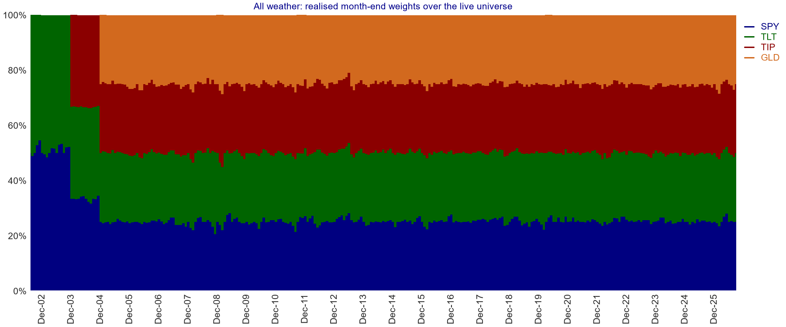
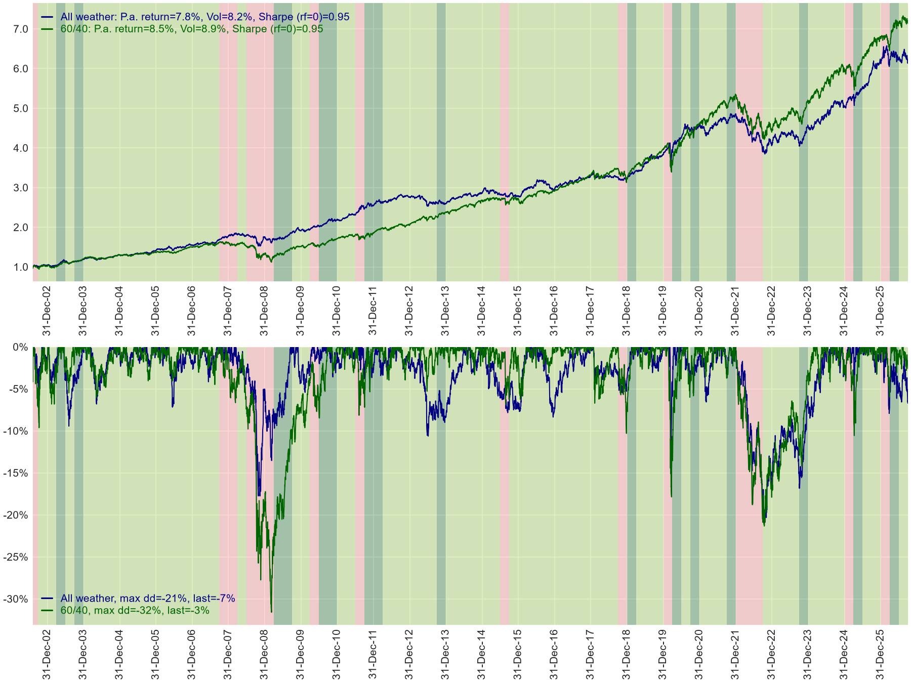
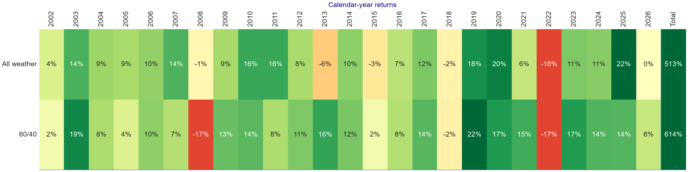
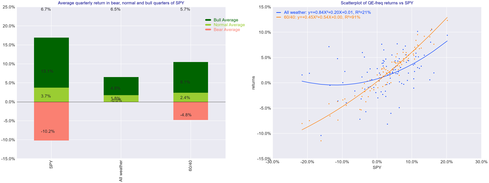
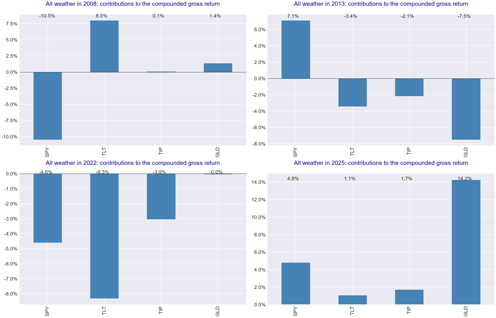
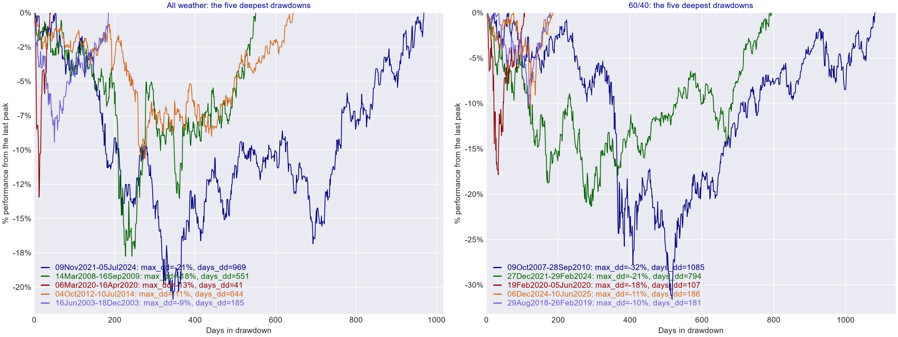
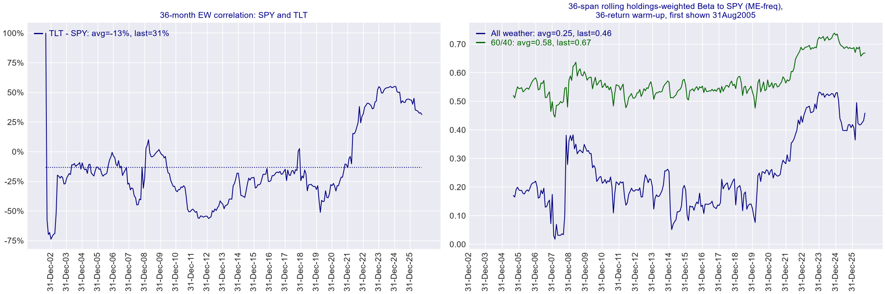
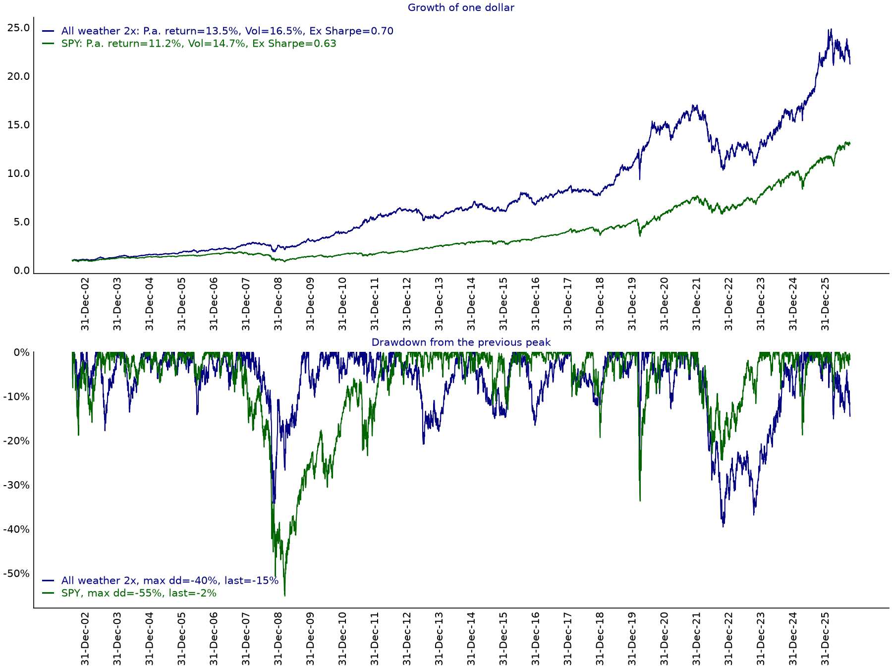
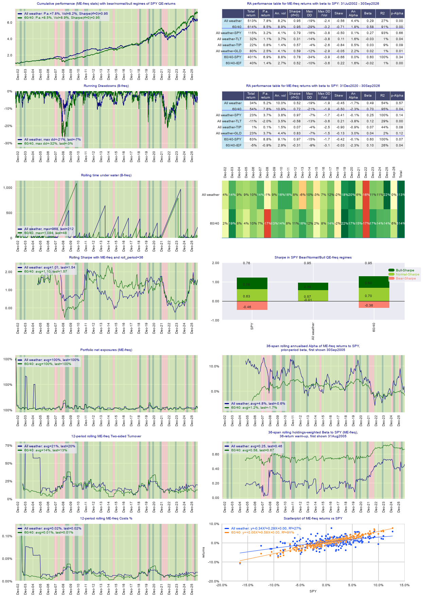
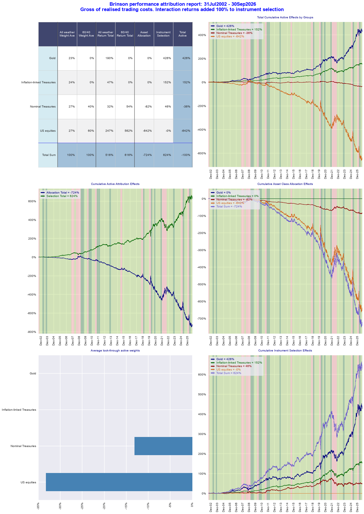

# qis package for performance analytics and portfolio backtesting: Example of Application for All weather or 60/40 Portfolios and qis vs Gen AI

*Artur Sepp · 11 November 2026*

My paper
[qis: reproducible performance analytics and portfolio backtesting in Python](https://doi.org/10.21105/joss.11400)
was published in the Journal of Open Source Software on 18 October 2026. `qis` is the Python
package behind the analytics of my research papers, and it has been downloaded
244K times from PyPI as of 11 November 2026. [Download history](https://pepy.tech/projects/qis)


Contents:

1. [Why `qis`](#why-qis): the problem I built it for, and what it covers today.
2. [An example](#example-of-using-qis-for-all-weather-portfolio-analysis): is an all-weather portfolio better than the classic 60/40, and when?
3. [`qis` in the era of Gen AI](#qis-in-the-era-of-gen-ai): what a package is for when an AI writes the code.


## Why qis


I started to develop `qis` and made it open source around 2022, for the reason that many times I faced a simple research problem.
I was using public and private packages for exploring and developing quant strategies that generate position weights for me.
What I found missing was a simple portfolio backtester that will reconstruct the P&L from the weights and prices I provide.
That backtester should work uniformly whether the underlying strategies cover a universe of several thousand stocks with long-short self-financing weights,
a universe of a dozen self-financing futures positions, DeFi staking strategies with cash flows, or simple long-only ETFs.


One function for generating the net asset value or the equty curve of the portfolio serves the four cases because it assumes little. 
The weights do not have to sum to one, and the cash balance is explicit.
Between rebalancings the backtester holds units, not weights, so the realised weights drift with prices and the reported turnover is the traded one. 
Its accounting is 460 lines of code.

For all these cases I wanted to have a simple mechanism:

- My algo produces position weights for the provided universe along with estimated trading costs ar reblancing times

- The universe has valid prices accounting for total returns

- Leverage / balances are funded / accrued at the specified rate


Each requirement is an argument of `qis.backtest_model_portfolio`:

| Requirement | Argument                                                                                                                                    |
|---|---------------------------------------------------------------------------------------------------------------------------------------------|
| Position weights | `weights`: a dict for a static allocation, a dated DataFrame for a strategy; `weight_implementation_lag` delays the trade of a dated weight |
| Trading costs | `rebalancing_costs`: one number, a series by instrument, or a DataFrame of dates by instruments                                             |
| Total-return prices | `prices`; `instruments_carry` for a carry that is not in the price, such as a staking yield or borrow costs                                 |
| Funding | `funding_rate` on positive and negative cash, `management_fee` on the net asset value                                                       |


The backtester then provides the net asset value of the trading account along with the different performance measures, turnover and risk analysis, comparison to benchmarks, regime-conditional performance etc.


The output is a `PortfolioData` object with the net asset value, the units, the realised weights, the P&L of each instrument and the realised costs. The tables and charts of the example below are read from it.

Along with that I wanted to have different visualisation methods. For example, a scatter plot of strategy returns vs benchmark returns. It may be a trivial task to generate the code by prompting an AI these days, but in the pre-AI days you had to know the matplotlib settings at length to make a proper scatter plot and to display the estimated regression coefficient on it. What I did is to create API-like interfaces for the core plots that I need for reporting of financial data: time series, stack plots, scatter plots, box plots, bar charts with uniform styling and labelling. These APIs are linked to factsheet generation.


The functions are `qis.plot_time_series`, `qis.plot_stack`, `qis.plot_scatter`, `qis.df_boxplot_by_classification_var`, `qis.plot_bars` and `qis.plot_heatmap`. Each draws on a matplotlib axis passed as `ax=`. The scatter plot of my example is the right panel of Figure 3 below: its legend prints the fitted quadratic and its R<sup>2</sup>.

With time I also developed backtest reporting factsheets focused on core analyses such as:

- [strategy factsheet](https://quantinveststrats.readthedocs.io/en/stable/gallery.html#single-strategy): when I think of presenting the strategy as a stand-alone: its risk, turnover, performance heatmap, diagnostics of the Sharpe ratio and alpha, etc.

- [strategy-benchmark factsheet](https://quantinveststrats.readthedocs.io/en/stable/gallery.html#strategy-vs-benchmark): when I analyse a new strategy feature vs the base strategy: what this feature provides marginally, Brinson decomposition, etc.

- [multi-strategy factsheet](https://quantinveststrats.readthedocs.io/en/stable/gallery.html#multiple-strategies): when I analyse a block of strategies or the sensitivity to a specific parameter

- [multi-asset factsheet](https://quantinveststrats.readthedocs.io/en/stable/gallery.html#multi-asset-universe): a simple report for a multi-asset universe where strategy weights are not analysed and only a cross-sectional measure of performance is requested.


Each report answers one question:

| Factsheet | The question it answers | What it shows |
|---|---|---|
| Strategy | How did I earn this return? | Exposures, turnover and trading costs next to the net asset value. A page of inference adds intervals for the Sharpe ratio and for the alpha to the benchmark |
| Strategy-benchmark | What did my change contribute? | The three pages of the example below: the outcomes of both portfolios, the paired Sharpe difference and the marginal alpha, and the Brinson allocation and selection effects |
| Multi-strategy | Does the conclusion survive a change of parameters? | Several variants against one base portfolio, with p-values adjusted for multiple comparisons |
| Multi-asset | What can I learn before choosing weights? | From a price panel alone: performance, drawdowns, correlations and the behaviour in the regimes of a benchmark |


Tracking error is reported before and after the fact. Before trading, the active weights and a dated covariance matrix give an ex-ante tracking error, through `qis.RiskModel`. After trading, the realised return differences show how far the strategy moved from its benchmark, through `qis.compute_ewma_realised_tracking_error`.


The four reports share one entry point. `qis.factsheet(...)` selects the report from the type of its input and sets the rolling windows and the annualisation from the reporting frequency, and each panel prints the frequency it was computed at. The reports also cover risk contributions, value at risk, stress tests and signal diagnostics. I list them with their calls in the section "What else the reports cover" below.

With time I also added some features to `qis` that I constantly re-use in signal and portfolio construction and for which I wanted to have a common interface: exponentially weighted moving average (EWMA) filters, risk model, bootstrap, and FX adjustments among the key features.


The entry points are `qis.compute_ewm_vol` and `qis.estimate_rolling_ewma_covar` for the EWMA estimators, `qis.RiskModel` for exposures and tracking error from dated covariance matrices, `qis.bootstrap_price_data` for stationary and block bootstraps, and `qis.FxRatesData` for returns and hedges in a reference currency. The same group holds the unsmoothing of appraisal-based returns and the regime classifier that shades the charts of this post.

This makes `qis` a building tool for designing and reporting of quant strategies by delegating the reporting and tooling to a public method while keeping the focus on developing proprietary features for signal and portfolio construction that ultimately matter for the performance.


The boundary is deliberate: `qis` ships no optimiser and no signal library. The weights come from the researcher's own code or from the other packages of my stack, such as `optimalportfolios`.


## Example of using qis for all-weather portfolio analysis


I do not summarise the paper further - [read the paper further](https://doi.org/10.21105/joss.11400) for my motivation, comparison to peer packages and other details.
I use the package the way I use it every day: to answer a
question about portfolios. For this post I choose an interesting one: is an all-weather portfolio
better than the classic 60/40, and if so, when? I will not dwell on the details of how to construct
an all-weather portfolio - let's pick a proxy using a static weights portfolio. Mine is a
simplification with equal capital in each ETF: the all-weather portfolio holds 25% each in US
equities (SPY), long-term Treasuries (TLT), inflation-linked Treasuries (TIP) and gold (GLD). It
follows the idea of Bridgewater's All Weather approach, to hold assets for rising and falling
growth and inflation
([The All Weather Story](https://www.bridgewater.com/research-and-insights/the-all-weather-story)),
without its risk balancing and its leverage. The 60/40 portfolio holds 60% in SPY and 40% in 7-10
year Treasuries (IEF). Both are rebalanced quarterly and pay 10 basis points on each trade.


This is a typical problem an investor or an advisor faces. Good luck solving it with AI and getting all the details right.


The details are the launch dates of the ETFs, the drift of the weights between rebalancings, the trading costs, the return frequency behind a volatility and the definition of a Sharpe ratio. I come back to them with an AI at the end of the post.

Here, every panel below comes from one line of code, printed above it. Changing the question costs
one line.

### Two portfolios in fifteen lines

```python
import yfinance as yf
import qis

tickers = ['SPY', 'TLT', 'TIP', 'GLD', 'IEF']
prices = yf.download(tickers, start='2002-07-31', end='2026-10-01', ignore_tz=True, auto_adjust=True)['Close'][tickers]
prices = prices.asfreq('B', method='ffill')  # an ETF stays empty before its launch

def backtest(weights, ticker, funding_rate=None):
    px = prices[list(weights)]
    schedule = qis.generate_static_weights_schedule(prices=px, weights=weights, rebalancing_freq='QE')
    return qis.backtest_model_portfolio(prices=px, weights=schedule, rebalancing_freq=None,
                                        rebalancing_costs=0.0010,  # fractional units: 10 bp
                                        funding_rate=funding_rate, ticker=ticker)

all_weather = backtest({'SPY': 0.25, 'TLT': 0.25, 'TIP': 0.25, 'GLD': 0.25}, 'All weather')
balanced = backtest({'SPY': 0.60, 'IEF': 0.40}, '60/40')
portfolios = qis.MultiPortfolioData(portfolio_datas=[all_weather, balanced], benchmark_prices=prices['SPY'])
perf_params = qis.PerfParams(freq='ME')  # statistics on monthly returns
```


TIP started trading in December 2003 and GLD in November 2004. I do not cut the history to the
date when all four ETFs exist. `generate_static_weights_schedule` spreads the target over the
ETFs that have a price at each rebalancing date: half each in SPY and TLT from July 2002, a
third in each of three ETFs from December 2003, and a quarter in each of four from December 2004.
Both portfolios start on 31 July 2002.

The last two lines matter most. `MultiPortfolioData` holds the two backtests with their prices,
weights, trades and costs, and each question below is one call on this object.


The backtester holds units between the rebalancing dates, so the trades are the ones that return the drifted weights to their targets. Over the 21 complete years from 2005 through 2025, the annual sum of buys and sells averaged 16.20% of NAV for all weather and 14.30% for 60/40. At 10 basis points per dollar traded, that cost 1.62 and 1.43 basis points of NAV a year. I sum each trade relative to that day’s NAV and then average the calendar-year totals. [Annual turnover and costs](results/table_annual_turnover_costs.csv)



*Opening allocation. Monthly holdings drift between quarterly trades. TIP enters in December 2003 and GLD in December 2004.*

### Which one did better?

```python
portfolios.plot_nav(regime_benchmark='SPY', perf_params=perf_params, ax=ax)
portfolios.plot_drawdowns(regime_benchmark='SPY', ax=ax)
```



*Figure 1. Net asset values and running drawdowns, 31 July 2002 to 30 September 2026. The pink
and the dark green bands are the bear and the bull quarters of SPY.*

Over 24 years the 60/40 portfolio returns 8.5% p.a. and all weather 7.8%, with volatilities of
8.9% and 8.2%. The Sharpe ratio is 0.95 for both. The deepest drawdown is -32% for 60/40 and
-21% for all weather.

So the two portfolios earn the same return per unit of risk. Figure 1 already shows that they
do not earn it in the same years: all weather is ahead in cumulative wealth at every year-end from 2005 through 2016, and 60/40 pulls away
after 2020.


The same Sharpe ratio does not make them the same portfolio. Regressed on SPY with monthly returns, the 60/40 portfolio has a beta of 0.58 and an R<sup>2</sup> of 91%, and all weather a beta of 0.29 and an R<sup>2</sup> of 27%. Both are columns of `qis.compute_ra_perf_table_with_benchmark`.

### In which years?

```python
portfolios.plot_periodic_returns(ax=ax)
```



*Figure 2. Calendar-year returns. 2002 starts on 31 July and 2026 ends on 30 September.*

All weather is ahead in 10 of the 23 complete years, and in two of them, 2018 and 2022, by less
than one point. The large gaps go both ways. In 2008 all weather loses 1% and 60/40 loses 17%.
In 2013 all weather loses 6% while 60/40 gains 16%. In 2025 it gains 22% against 14%.

The years cluster. A window of dates is a `qis.TimePeriod`, and the same performance table can
be computed on any window:

```python
qis.compute_ra_perf_table(prices=qis.TimePeriod('31Dec2012', '31Dec2021').locate(portfolios.get_navs()),
                          perf_params=perf_params)
```

| Return p.a. | All weather | 60/40 |
|---|---:|---:|
| July 2002 to 2012 | 10.2% | 7.2% |
| 2013 to 2021 | 6.5% | 11.2% |
| 2022 to September 2026 | 5.0% | 6.3% |

An investor who looked at these two portfolios at the end of 2012 saw all weather three points
a year ahead, with a deepest drawdown of 18% against 32%. The next nine years went the other way
by almost five points a year.

### What kind of market favours it?

```python
portfolios.plot_regime_data(benchmark='SPY', regime_data_to_plot=qis.RegimeData.REGIME_AVG,
                            perf_params=perf_params, yvar_format='{:.1%}', ax=ax)
portfolios.plot_returns_scatter(benchmark='SPY', freq='QE', ax=ax)
```



*Figure 3. Left: average quarterly return in the bear, normal and bull quarters of SPY, which
are the worst 16%, the middle and the best 16% of its quarterly returns. The bars are stacked
and the number on top is their sum. Right: quarterly returns against SPY with a quadratic fit.*

In the 16 worst quarters of SPY, equities lose 10.2% on average, 60/40 loses 4.8% and all
weather is flat. In the 16 best quarters all weather gains 4.8% and 60/40 gains 8.1%. The
fitted curve on the right is flat for all weather when SPY falls, and close to a straight line
for 60/40.

The same holds month by month. All weather is ahead in 70% of the months in which 60/40 falls,
and in 34% of the months in which it rises. It is a portfolio for the quarters that an investor
would rather forget, and it pays for this in the other quarters.


The same classification splits the Sharpe ratio, with `regime_data_to_plot=qis.RegimeData.REGIME_SHARPE` in the call above. The 0.95 of the 60/40 portfolio is 0.60 from the bull quarters, 0.70 from the normal quarters and -0.36 from the bear quarters, up to rounding. For all weather it is 0.38, 0.57 and -0.01: it earns less in the good quarters and gives nothing back in the bad ones.

### Which ETF did the work?

```python
all_weather.plot_performance_attribution(time_period=qis.TimePeriod('31Dec2021', '31Dec2022'), ax=ax)
```



*Figure 4. Contribution of each ETF to the return of the all-weather portfolio in four years. The
bars of a year add up to its return before trading costs. Each day’s contribution is scaled by the gross portfolio wealth at the preceding close, starting from one dollar at the opening of that calendar year.* [Data behind the bars](results/table_attribution.csv)

Each of the four years has a different story.

- **2008.** SPY costs 10.5 points and TLT gives back 8.0. The portfolio ends the year at -1%.
- **2013.** SPY adds 7.1 points, and gold takes 7.5 away. The two bond ETFs lose another 5.6.
- **2022.** TLT loses 8.3 points, SPY 4.6 and TIP 3.0. Gold is flat. Three of the four ETFs
  fall together, and nothing offsets them. In this year all weather loses 16% and 60/40 loses 17%.
- **2025.** Gold adds 14.2 percentage points to the gross return. The portfolio finishes the year up 21.8% after trading costs.

Over the full sample SPY and GLD contribute 247 and 190 of the 516 points of return before
costs. TLT and TIP hold at least half of the capital at every rebalancing and contribute 79.
The risk is not equal either: with `qis.compute_portfolio_risk_contribution_ratios`, gold has 25%
of the capital and 39% of the volatility.

### How bad did it get?

```python
qis.plot_top_drawdowns_paths(all_weather.get_portfolio_nav(), max_num=5, ax=ax)
```



*Figure 5. Paths of the five deepest drawdowns of each portfolio, from the peak to the recovery.*

The deepest drawdown of all weather is not 2008. It starts on 9 November 2021, reaches -20.9% on
20 October 2022 and ends on 5 July 2024, after 969 days. The 60/40 portfolio falls 21.3% in the
same episode and recovers in 794 days. Its own deepest drawdown is the financial crisis: -31.6%
and 1,085 days. March 2020 looks different: all weather loses 13.5% in 12 days and recovers
within a month of the trough, 41 calendar days after its previous peak.


### What changed after 2021?

```python
qis.plot_returns_corr_matrix_time_series(prices=prices[['SPY', 'TLT']], freq='ME', span=36, ax=ax)
portfolios.plot_factor_betas(benchmark_prices=prices[['SPY']], freq_beta='ME', factor_beta_span=36, axs=[ax])
```



*Figure 6. Left: correlation of the monthly returns of SPY and TLT, exponentially weighted with a
span of 36 months. Right: beta of each portfolio to SPY, computed from the betas of its holdings. The first portfolio betas appear on 31 August 2005. Each holding needs 36 paired monthly returns with SPY for warm-up and first contributes a beta on its 37th paired return. During the early warm-up, the panel uses the available instrument betas at their actual weights. All held instruments have coverage by December 2007.*

In 2022 three of the four ETFs fell together, and the attribution does not say why. The reason is
the correlation of bonds with equities. Using monthly log returns, the ordinary sample correlation of SPY and TLT is
-0.31 from 2005 to 2012, of -0.26 from 2013 to 2021, and of +0.58 from 2022 to September 2026.

The portfolio changes with it. The beta of all weather to SPY is 0.28 at the end of 2021, reaches
0.53 in December 2023 and stands at 0.46 in September 2026.

This completes the answer to "when": all weather is ahead when bonds hedge equities, and since
2022 they have not.

The three correlations above use 96, 108 and 57 monthly returns. The rolling line in Figure 6 gives greater weight to recent months and ends at +0.31. The shift in the sample average describes the period as a whole; individual months still varied. [Period correlations](results/table_spy_tlt_correlation.csv) · [Monthly correlation and beta series](results/series_correlation_beta.csv)

### Is the difference real?

```python
portfolios.get_sharpe_difference_table()
```

The table tests the Sharpe ratio of 60/40 against all weather on their 290 common monthly
returns. The difference is 0.005 with a standard error of 0.17 and a p-value of 0.98. Twenty-four
years of data cannot tell the two portfolios apart by their Sharpe ratios. They differ in the
years in which they disappoint.


The test and Figure 1 do not use the same Sharpe ratio. Figure 1 divides the compound return p.a. by the volatility: 0.946 for all weather and 0.948 for 60/40. The test uses the arithmetic mean of the monthly returns: 0.956 and 0.961. `qis` names its Sharpe conventions, and each table states the one it uses.


The second page of the factsheet below adds the path. At every year-end from 2007 to 2012, the trailing five-year arithmetic Sharpe favours all weather. The monthly difference briefly crosses zero in June and July 2013. It then favours 60/40 at every month-end from September 2013 through February 2020, before turning positive in March 2020. In September 2026 it ends at −0.083, with a pointwise 95% interval of −0.559 to +0.393. The sign here is all weather minus 60/40. [Five-year rolling estimates and intervals](results/series_rolling_sharpe_difference.csv) With the difference in the betas to SPY taken out, all weather is ahead by 2.1% p.a. over the 225 eligible months from January 2008, with a 95% interval from -0.3% to 4.5%, which includes zero.


### What if I add leverage?


```python
ust_3m = yf.download('^IRX', start='2002-07-01', end='2026-10-01', ignore_tz=True, auto_adjust=True)['Close']['^IRX'].dropna() / 100.0
levered = backtest({'SPY': 0.50, 'TLT': 0.50, 'TIP': 0.50, 'GLD': 0.50}, 'All weather 2x', funding_rate=ust_3m)
perf_params_excess = qis.PerfParams(freq='ME', rates_data=ust_3m)  # Sharpe ratios in excess of the bill rate
```

All weather has about the volatility of the 60/40 portfolio and a lower return. Bridgewater's All
Weather uses leverage, so I add it. The same four ETFs now hold 50% of the capital each, which is
200% in total, and the borrowed 100% pays the rate of the 3-month Treasury bill. This is the
`funding_rate` of the backtester: it accrues on the cash balance, which is now negative. I use the last annual bill quote available at the previous portfolio date and accrue interest over the actual calendar days on a 365-day basis. The [QIS reference script](qis_reference.py) runs this comparison with `--with-leverage` and can reuse the [saved annual rates](data/ust_3m_irx.csv).

| Portfolio | Return p.a. | Volatility p.a. | Excess Sharpe | Maximum drawdown | 2022 return |
|---|---:|---:|---:|---:|---:|
| All weather | 7.79% | 8.24% | 0.726 | −20.90% | −16.01% |
| 60/40 | 8.47% | 8.94% | 0.744 | −31.60% | −16.77% |
| All weather 2x | 13.48% | 16.52% | 0.701 | −39.58% | −32.45% |
| SPY | 11.20% | 14.75% | 0.633 | −55.19% | −18.18% |



*Figure 7. The funded 2× portfolio and SPY from 31 July 2002 to 30 September 2026. Both series start at one dollar. Drawdowns are measured from each series’ previous peak.*

With leverage, the comparison I find more informative is SPY. The 2× portfolio earned 13.48% a year at 16.52% volatility, against 11.20% at 14.75% for SPY. Within the all-weather allocation, doubling the target exposure lifted the annualised return from 7.79% to 13.48%. Its excess Sharpe fell from 0.726 to 0.701 after financing and trading costs.

The price of the extra exposure was clearest in 2022. The funded portfolio lost 32.45% that calendar year, against 16.01% for unlevered all weather and 18.18% for SPY. Its deepest drawdown began on 9 November 2021, reached 39.58% on 20 October 2022 and recovered on 31 March 2025. That was 1,238 calendar days from peak to recovery.

With a funding rate in the backtest, a Sharpe ratio with a zero rate is no longer the right
statistic. The Sharpe ratios of this section are in excess of the bill rate, which `PerfParams`
takes as `rates_data`. On this convention the unlevered Sharpe ratios are 0.726 for all weather and 0.744 for 60/40. Funding at the bill rate with no spread is a
lower bound on the cost of leverage.


### The whole report in one call

```python
figs = qis.factsheet(portfolios, kind='strategy_benchmark')
qis.save_figs_to_pdf(figs=figs, file_name='aw6040_factsheet', local_path=None)
```

[](results/aw6040_factsheet.pdf)

*Figure 8. First page of the factsheet of all weather against 60/40. For both portfolios, rolling alpha starts on 30 September 2005. The first observation is September’s portfolio log return less the 31 August beta times September’s SPY log return. This residual seeds the 36-span average, which is annualised by multiplying by 12. Earlier months are blank. The marginal-alpha comparison on page two begins in January 2008, once both portfolios have a fully covered opening beta.*

Most figures above are panels of this report. `qis.factsheet` produces three pages: the
performance report with the rolling statistics, the exposures, the turnover and the costs of both
portfolios, a page with the paired test of the Sharpe ratios, and a Brinson attribution of all
weather against 60/40. I start an analysis from this report and then pull out single panels, as
in this post.


The third page says where the difference comes from. Before costs, all weather returns 516% and the 60/40 portfolio 616%. Of these 100 points, the lower weight of equities, 27% on average against 60%, costs 642. Gold adds 426, TLT 241 and TIP 152, and not holding IEF costs 277. With `group_data`, a series that maps each ETF to its asset class, the same call draws the page by asset class. Grouping TLT and IEF together shows how the two Treasury choices worked. The lower weight in nominal Treasuries cost 82.31 percentage points of linked active return. Instrument selection within that group added 46.12 points, leaving a net contribution of −36.18 points. The four groups together reconcile to the full-sample gross return gap of −100.13 percentage points. [Grouped Brinson table](results/table_brinson_asset_classes.csv) · [Three-page grouped factsheet](results/aw6040_grouped_factsheet.pdf)




*Supplement to Figure 8. TLT and IEF are grouped as nominal Treasuries; inflation-linked Treasuries, US equities and gold each retain their own group.*

### What else the reports cover

The factsheets are a part of what `qis` reports. The table lists the rest: performance and risk
after the fact (ex post), and risk before it (ex ante). Some function names abbreviate tracking
error to TRE.

| Question | Call | Content |
|---|---|---|
| Ex-post performance | `qis.compute_ra_perf_table`, the factsheets | Return, volatility, Sharpe ratio under three named conventions, drawdowns, alpha and beta to a benchmark, regime contributions, attribution, Brinson, turnover and costs |
| Is a difference significant? | `MultiPortfolioData.get_sharpe_difference_table`, the second page of the strategy-benchmark factsheet | Paired Sharpe difference and marginal alpha with autocorrelation-consistent intervals |
| Ex-post tracking error | `qis.compute_ewma_realised_tracking_error`, `qis.compute_te_ir_errors` | A series for monitoring; tracking error and information ratio of the whole sample |
| Ex-ante risk | `qis.RiskModel`, `PortfolioData.plot_current_var` | Tracking error by group, factor exposures, beta, marginal contributions and value at risk, from weights and dated covariance matrices |
| Tracking-error report | `qis.weights_tracking_error_report_by_ac_subac` | Strategy against benchmark by asset class: weights, tracking error, risk contributions, turnover |
| Stress tests | `qis.generate_portfolio_stress_report` | Factor shocks applied to the current holdings |
| Signals | `qis.generate_weight_change_report` | What moved the weights: momentum, carry, target volatility, leverage |
| Look-through and FX | `qis.generate_lookthrough_exposures_factsheet`, `qis.run_asset_fx_hedging_report` | Exposures through fund holdings; hedged returns in a reference currency |


### Conventions

Prices are Yahoo adjusted closes, downloaded on 11 November 2026, with qis 6.0.1. Returns,
volatilities and Sharpe ratios use monthly returns; the Sharpe ratio is the compound return p.a.
over the volatility with a zero risk-free rate. Drawdowns use daily values. Trading costs are
10 basis points of the traded notional. There are no taxes and no interest on cash. The [QIS reference script](qis_reference.py) produces the unlevered ETF comparison by default. The `--with-leverage` option also produces the funded table and Figure 7.


The test of the Sharpe difference departs from this and uses the arithmetic Sharpe ratio. The section on leverage funds the cash balance at the 3-month Treasury bill rate and reports Sharpe ratios in excess of it.


### Try it yourself

Each experiment is a new dict of weights in the setup and the same calls.

- Replace TLT with IEF, and see what shorter bonds do to 2022 and to 2008.
- Move to 40% gold and 20% in each of the others, and look at 2013.
- Add the variant to `MultiPortfolioData` and read the Sharpe difference table before you
  believe the improvement.


- Change `'QE'` to `'ME'` or `'YE'` in `backtest`, and see how little the rebalancing frequency matters.
- Add a spread to the funding of the levered portfolio, `funding_rate=ust_3m + 0.005`, and compare it with SPY again.


### The same research with an AI


I gave Claude Opus 5.5 High, DeepSeek and ChatGPT High the same question in three fresh chats. I supplied the asset classes, weights, dates, quarterly rebalancing rule and 10 basis points of trading costs. I left the choice of ETFs, software, missing-history rule and Sharpe convention to each model. I asked when all weather beat 60/40 and which holdings explained the three largest annual gaps. [Full prompt and run commands](README.md#prompt-used-in-the-three-chats).

All three picked SPY, TLT, TIP and GLD for all weather and SPY and IEF for 60/40. The first trade on 31 July 2002 was where their answers diverged. My QIS account invested 50% each in SPY and TLT. Claude put 25% in each and held the remaining 50% in Treasury bills. DeepSeek kept four equal exposures by adding a TIPS mutual fund (VIPSX) and a continuous gold futures series. ChatGPT used the same TIPS fund and a bullion price series with a 0.40% annual expense allowance. ChatGPT charged for both sides of each proxy-to-ETF exchange at quarter-end. DeepSeek spliced the returns at the first available ETF return without recording a switch trade.

I ran their scripts on 11 November 2026 in the Python environment used for this post (`qis 6.0.1`). Each fetched its own data. The table gives **all weather / 60/40** in that order. A win is a complete calendar year in which all weather finished ahead. The partial years 2002 and 2026 are excluded from the count.

| Script | Return p.a. | Volatility p.a. | Sharpe | Maximum drawdown | Wins out of 23 |
|---|---:|---:|---:|---:|---:|
| [QIS reference](qis_reference.py) | 7.79% / 8.47% | 8.24% / 8.94% | 0.946 / 0.948 | −20.90% / −31.60% | 10 |
| [Claude Opus 5.5 High](claude_opus_5_5_high.py) | 7.35% / 8.46% | 7.87% / 10.46% | 0.722 / 0.665 | −20.90% / −31.62% | 9 |
| [DeepSeek](deepseek.py) | 7.85% / 8.46% | 8.00% / 10.46% | 0.773 / 0.667 | −20.90% / −31.62% | 10 |
| [ChatGPT High](chatgpt_high.py) | 7.82% / 8.46% | 7.98% / 10.46% | 0.763 / 0.661 | −20.90% / −31.62% | 9 |

**How much did the first trade matter?** I reran Claude’s script with its `--missing renormalize` option, using the same cached prices and Treasury rates. Reallocating the missing sleeves to the available ETFs raised annualised all-weather return from 7.35% to 7.78%, close to the QIS result of 7.79%. The extra winning year was 2004. All weather finished 1.14 percentage points ahead of 60/40 in the QIS run. DeepSeek had it ahead by 0.15 points, ChatGPT behind by 0.15 and Claude’s original cash allocation behind by 0.85.

**Why did the same 60/40 have two volatilities?** All three scripts used daily returns. Recomputing volatility from my saved 60/40 NAV on trading days gives 10.46%, the figure in all three replies’ scripts. Figure 1 reports 8.94% using monthly volatility. The scripts also compute Sharpe from arithmetic daily returns in excess of a three-month Treasury rate. My headline Sharpe uses compound annual return divided by annualised monthly volatility at a zero risk-free rate.

**Which years, and why?** My three largest absolute gaps were 2013 (all weather behind by 21.78 points), 2008 (ahead by 16.15) and 2021 (behind by 9.13). DeepSeek and ChatGPT ranked the same years. With its original cash allocation, Claude ranked 2003 third across all complete years (behind by 11.15 points). Its detailed attribution starts with the fully invested years and therefore reports 2021 instead.

The 2008 result shows what the code adds to a plausible explanation. ChatGPT’s written reply estimated a **+0.38%** all-weather return from annual ETF returns and target weights. Its quarterly backtest produced **−1.10%**, matching QIS to two decimals. ChatGPT and Claude each attributed about **13.23 points** of the advantage over 60/40 to the smaller equity position and **7.97 points** to TLT, while the IEF held by 60/40 reduced the gap by **6.47 points**. Their holding-level dollar P&L and trading costs reconcile to the annual return. DeepSeek summed daily percentage contributions. Its all-weather contributions totalled −0.39 points against its compounded return of −1.10%.

Claude and DeepSeek ran as supplied. ChatGPT’s original script timed out twice downloading FRED’s DGS3MO series. Switching the FRED request to the default Python Requests user agent let the script run with the same URL and rate series. That header is the only edit to the supplied code. [Saved model outputs and offline replay](replay_ai.py)

<details>
<summary>Earlier open-ended prompt from the planning draft</summary>


I gave the question of this post to an AI as I would give it to a colleague: without `qis`,
without the ETFs and without a specification.

> Is an all-weather portfolio better than the classic 60/40 portfolio, and if so, when?
>
> Answer with a backtest on public data. Write one Python script that downloads the data,
> backtests both portfolios and prints: the first and the last date of the backtest; for each
> portfolio the annual return, the volatility, the Sharpe ratio and the maximum drawdown; and a
> table of calendar-year returns. Save the daily portfolio values to navs.csv.
>
> After the script, list in a table of at most ten rows every choice you made that I did not
> specify. You cannot run the script, so do not quote results.

</details>


## `qis` in the era of Gen AI

I understand that in the era of AI most of the analysis that `qis` provides can be generated quickly. What makes `qis` viable is the harness: consistent treatment of NaN data, all conventions are documented (Sharpe ratio - arithmetic, compounded, excess, etc., volatility frequency, alpha and beta versus the benchmark, start and end dates) and synchronised across the reporting. I see `qis` as a harness for agentic work. All my repositories have an explicit setting in SKILL.md or AGENTS.md to always use `qis` for any type of backtesting and reporting, and never to invent something that is not available there or to re-create something that is.


The portfolio of this post gives the evidence. On 10 November 2026 I asked one model, Claude Opus 5.5, for the backtest of the all-weather portfolio from 31 July 2002 in four ways, and ran the four scripts.

| Prompt | Start of the backtest | Total return |
|---|---|---:|
| The task only | 18 November 2004 | 368% |
| The task, with `qis` named | 18 November 2004 | 373% |
| The task and a specification | 31 July 2002 | 513% |
| The task, the specification and `qis` | 31 July 2002 | 513% |
| This post | 31 July 2002 | 513% |


Without a specification the model started on 18 November 2004, the first day on which all four ETFs have a price, with `qis` and without it. It said so and described the alternative. On the accounting of this post the return from that date is 376%, so the start date explains most of the gap. Its script without `qis` also rebalanced monthly, charged no trading costs and used daily returns for the volatility. With a specification of 280 words the same model reproduced the net asset value of `qis` to within 0.0005 on every day, from a start of 100. [Recorded four-prompt comparison](experiments/four_prompts/ai_comparison_table.csv)


The specification is the point. Every line of it is a convention that `qis` implements once and documents, so the chart, the table and the factsheet of one strategy show one number under one stated convention. Without the package each answer is a new implementation, 119 and 125 lines in these runs, that has to be read before its numbers can be compared with anything.


An agent also has to find the function. The documented core is `CORE_API` in `qis/api.py`, 183 symbols in 14 groups, and a test fails when a documented argument is not in the signature. The rule in my agent instructions is a table. Four of its rows:

| You need to | Call | Do not write |
|---|---|---|
| Turn weights into a portfolio | `qis.backtest_model_portfolio` | a date loop accumulating P&L |
| Performance statistics | `qis.compute_ra_perf_table` | Sharpe, vol or drawdown by hand |
| Returns to NAV | `qis.returns_to_nav` | `(1 + r).cumprod()` |
| Covariance on a ragged panel | `qis.compute_masked_covar_corr` | `.dropna().cov()` |

## Links

- Paper: Sepp, A. (2026), qis: reproducible performance analytics and portfolio backtesting in
  Python, *Journal of Open Source Software*, 11(126), 11400,
  [doi:10.21105/joss.11400](https://doi.org/10.21105/joss.11400)
- Code: [github.com/ArturSepp/QuantInvestStrats](https://github.com/ArturSepp/QuantInvestStrats)
- Documentation: [quantinveststrats.readthedocs.io](https://quantinveststrats.readthedocs.io/en/stable/)
- PyPI: [pypi.org/project/qis](https://pypi.org/project/qis/)

I thank the editor Daniel S. Katz and the reviewers @alex09x, @robertmartin8 and @tschm for the
review, and John D. Reynolds for his contributions to `qis`.

## Disclosure

The views in this post are my own and do not represent the views of my current or former
employers. The post and the software are not investment advice in any form.
